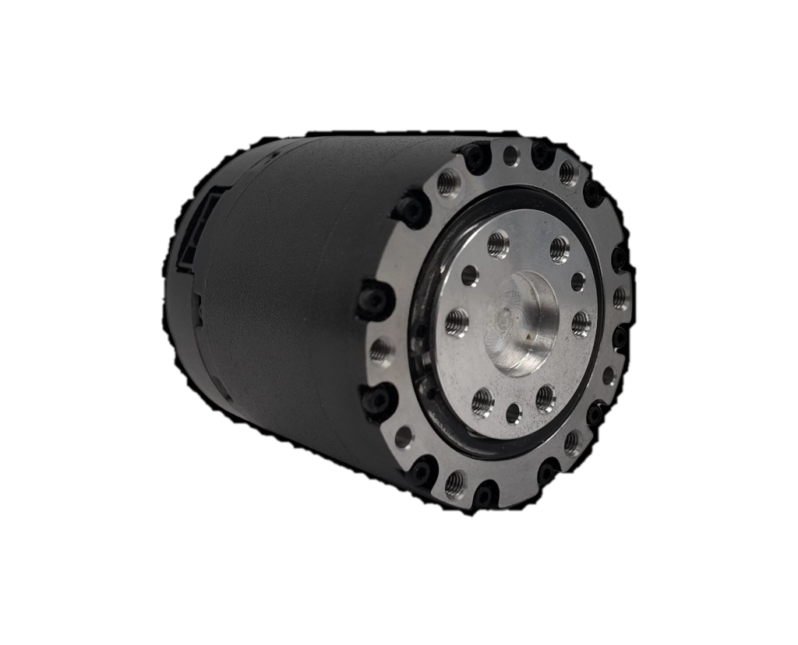
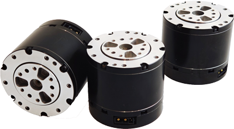

# PICO-Humanoid 机械设计

本仓库是 [PICO-Humanoid](https://github.com/pico-humanoid "访问项目主页") 负责机械设计部分的子项目，主要涵盖关节电机模型、机身结构设计等内容。

- 关节电机模型：[Motor/](Motor/ "进入 Motor/")
- 机械零件模型：[Part/](Part/ "进入 Part/") *Continuously updated...*
- 机身结构模型：*Coming soon...*
- 其他部件模型：*Coming soon...*
- 整机装配体：*Coming soon...*

> 使用 SolidWorks 进行机械设计，可参考[工具链指南](https://github.com/pico-humanoid/pico-humanoid.github.io/toolchain-guide.md "点击跳转")

## [关节电机](Motor/ "进入 Motor/")

- 采用 **灵足时代(RobStride)** 一体化关节模组
    - [RS-10P](https://www.robstride.com/products/robStride10P "访问产品官网") `.stp`：主电机，提供约 $14\mathrm{N\cdot m}$ 的额定扭矩

        

    - [RS-00](https://www.robstride.com/products/robStride00 "访问产品官网") `.step`：副电机，提供约 $5\mathrm{N\cdot m}$ 的额定扭矩

        

- 接口规格：**xt30(2+2)公口**（供电通讯一体化）

- GitHub 开源社区：
    - [RobStride 产品资料](https://github.com/RobStride/Product_Information "进入GitHub仓库")：电机图纸、3D 模型、规格参数、使用手册等

## [机械零件](Part/ "进入 Part/")

*例如螺丝、螺母、六角柱等。*

- 六角杯头螺丝 `.SLDPRT`
    - M3x6/8/10/12
    - M4x6/8/10/12

*Continuously updated...*

## 机身结构

- *采用层板式结构：不同板之间用M3/4六角柱连接，中空易走线*
    *最终采取碳纤维板/钣金件*
- *特殊部位（如头部、转接处、限位机构等）可用3D打印*

*Coming soon...*

PICO 以轻量易控为主要目标，目前采用 14-DoF 结构。

### 腿足

- `left/right_hip_pitch_joint`
- `left/right_hip_roll_joint`
- `left/right_hip_yaw_joint`
- `left/right_knee_joint`
- `left/right_ankle_roll_joint`
- `left/right_ankle_pitch_joint`

### 手臂

简洁为主，当前阶段能提供前后摆臂辅助运动即可，外形设计可着重考虑人形手臂弯曲程度
- `left/right_shoulder_pitch_joint`

### 躯干、腰部

- 不配备自由度，主要用于提供容纳空间和结构支撑
- 躯干：考虑电池、电路及电子设备的放置，手臂电机的放置
- 腰部（骨盆）：考虑腿部电机的放置，连接上下半身

### 其他

- 头部：考虑后期的双目相机等安装
- 手部：先考虑在臂上留有安装孔
- 考虑关节限位
- 预留孔位以备后续改进（如加装外壳）

## 其他部件

*例如电池、外壳、Jetson板、PCB模型等。*

*Coming soon...*

## 整机装配

*所有基本部件设计完成后进行整机装配。*

*Coming soon...*